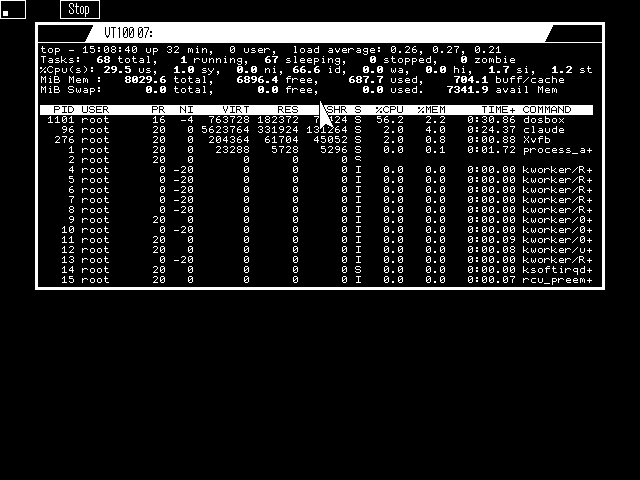

# MCVT — a VT100 terminal for the Psion MC400

MCVT is a native WIMP application for the Psion MC400 (and the MC series
SIBO laptops) that turns the machine into a VT100 terminal on its serial
port. It runs in a normal MC window, which can be moved, resized, maximised
and iconised, with bold, underline and inverse text, line drawing, UTF-8, and
menus and dialogs in the MC's own style.

It was built with the Psion SIBO (Series 3) C SDK against the MC400's
undocumented WIMP/OLIB object libraries in ROM, which were reverse-engineered
for this project.



## Features

- **VT100 emulation**: cursor addressing, erase, bold/underline/inverse,
  scroll regions, insert/delete lines and characters, tabs, DEC line drawing,
  wrap and origin modes, answers to device-attribute and cursor-position
  queries.
- **Copes with modern Linux output**: window-title (OSC) and DCS strings are
  swallowed, colour codes are ignored safely, and common xterm sequences
  (REP, CNL/CPL, alternate screen, size report) are handled. `top`, `nano`,
  `less`, `vi` and `btop` work.
- **UTF-8**: accented letters and box drawing are shown with the MC's
  code page 850 font; emoji and other double-width characters keep their
  columns. ISO 8859-1 can be chosen instead.
- **Resizable**: the terminal grid follows the window, up to about 89×34
  cells when maximised on the 640×400 screen (90×40 maximum).
- **Serial**: TTY:A or TTY:B, 50–19200 baud, XON/XOFF or RTS/CTS
  handshaking, set with the MC's built-in *Serial options* dialog.
- **Terminal options**: local echo, Backspace sends DEL or Ctrl-H,
  auto wrap, UTF-8.
- **Settings saved** in `M:\MCVT.INI`.

## Installing

1. Copy `release/MCVT.APP` to the MC (for example with a PsiWin/MCLink
   style link) into the directory where you keep applications.
2. Install it on the system screen the same way as other applications.
3. Connect the serial port to the host. Defaults are **TTY:A, 9600 baud,
   8N1, XON/XOFF**. Change them with **Options → Serial** (Psion-P).

## Using it

| Menu | Item | Key |
| --- | --- | --- |
| File | Clear screen | Psion-C |
| File | Reset terminal | Psion-R |
| File | Exit | Psion-E |
| Options | Serial… | Psion-P |
| Options | Terminal… | Psion-T |

Keys: the arrow keys send `ESC [ A`–`D` (or `ESC O` in application mode),
Backspace sends DEL (Shift-Backspace sends ^H; swap them in Terminal options),
Ctrl+letter sends the control code.

### Host set-up (Linux)

- Set the terminal type: `export TERM=vt100` (or `xterm`; colours are
  ignored).
- Flow control matters at 9600 baud. Make sure the host's serial port obeys
  XON/XOFF (`stty -F /dev/ttyUSB0 ixon`). **Over ssh** the ssh client turns
  `ixon` off on the local tty; re-enable it, for example with this in
  `~/.bashrc` on the machine the MC is cabled to:

  ```sh
  ssh() { local t=$(tty); ( trap '' TTOU; sleep 1; stty ixon < "$t" ) & command ssh "$@"; }
  ```

  or use RTS/CTS if your cable has the lines (tick RTS/CTS in MCVT and run
  `stty -F /dev/ttyUSB0 crtscts`).
- A serial line cannot tell the host when the window is resized. After
  resizing or maximising, tell it with:

  ```sh
  rsz() { printf '\0337\033[r\033[999;999H\033[6n\0338'; IFS='[;' read -sdR _ r c; stty rows $r cols $c; echo "${c}x${r}"; }
  ```

## Building

You need the Psion SIBO C SDK (TopSpeed C 3.10 with CTRAN and ECOBJ),
for example running in DOSBox, and Python 3 on the host.

1. Copy `src/` to `C:\PROJECTS\MCVT` and `mcinc/` to `C:\MCINC` in the SDK
   environment. `mcinc/` holds `olib.ext`, `wimp.ext`, `olib.g` and
   `wimp.g`: descriptions of the MC400 ROM's OLIB and WIMP classes for
   CTRAN, which the SDK does not include.
2. If you change the menus or dialog, regenerate the resource file on the
   host with `python3 mkrsc.py` (it writes `MCVT.RSC`; rcomp only knows
   Series 3 structures, so it is not used).
3. In the SDK: `cd \PROJECTS\MCVT` then `tsc /m mcvt`. The output is
   `MCVT.IMG`; rename it to `MCVT.APP`.

`MCVT.PIC`, the icon, is included prebuilt. `mkicon.py TERM.APP` rebuilds it
from the icon in your own copy of the MC's `TERM.APP`, adding "VT100" to the
terminal's screen.

Set `MCVT_DEBUG` to 1 in `O_MCVT.C` to write a debug log to `M:\MCVT.LOG`.

### Testing without an MC

The SDK's `SDBG.EXE` hosts an MC-like environment on the PC. Copy the build
over `SYS$BOOT.IMG` in the SDK's `SYS` directory (keep the original) and run
`sdbg`; the app starts in place of the debugger console. In DOSBox,
`serial1=nullmodem port:5000 transparent:1` puts SDBG's TTY:A on a TCP port
that a script or a pty bridge can talk to.

## Source layout

| File | Contents |
| --- | --- |
| `src/O_MCVT.C` | Application: start-up, window, keys, serial reader, menus, dialogs, settings |
| `src/VT.C`, `src/VT.H` | VT100 engine (derived from nfsc's `vt100.c`) |
| `src/CNV.H` | ISO 8859-1 ↔ code page 850 tables (from nfsc) |
| `src/MCVT.CAT` | CTRAN category file: the app's classes over OLIB and WIMP |
| `src/MCVT.PR`, `src/MCVT.AFL` | TopSpeed project and add-file list |
| `src/mkrsc.py` | Builds `MCVT.RSC` (title, menus, Terminal options dialog) |
| `src/mkicon.py` | Builds `MCVT.PIC` |
| `mcinc/` | OLIB/WIMP class descriptions for CTRAN |
| `docs/` | Window-server notes and screenshots |

## Credits

- The VT100 parser and the character-set tables come from **nfsc** by
  Rudolf Koenig, Michael Schroeder and Juergen Weigert (1993–1996),
  <https://github.com/thelastpsion/nfsc>, GPL-2.0.
- The icon is TERM.APP's icon from the MC400, edited; TERM.APP and its
  artwork are © Psion PLC.
- The release binary contains the Psion SIBO SDK's start-up code and
  library modules (`olib.lib`, `rlib.lib`, `p_*` routines), as every SDK-built
  application does. They are © Psion PLC and are not covered by this
  project's licence.
- Psion, MC400 and SIBO are trademarks of their respective owners. This
  project is not affiliated with or endorsed by them.

## Licence

MCVT is free software, released under the **GNU General Public License,
version 2** (GPL-2.0-only), the same licence as nfsc, from which part of it
is derived. See [LICENSE](LICENSE).

Copyright © 2026 Christian Farrow (zedstarr).
